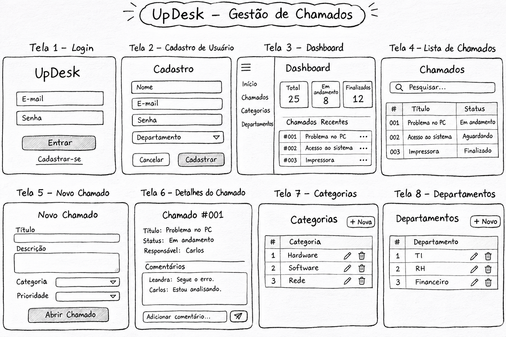
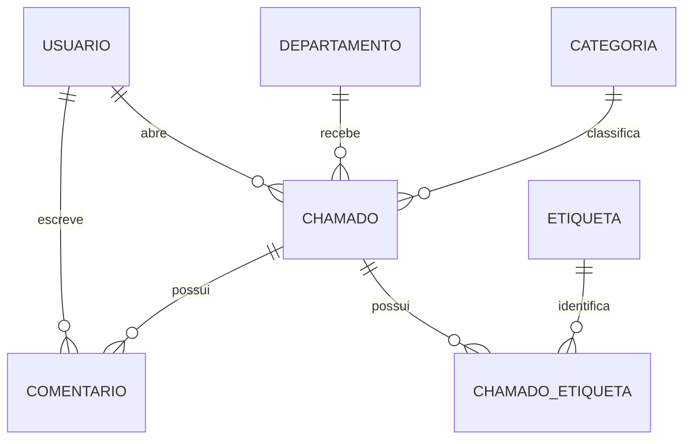

# UpDesk — Sistema de gerenciamento de chamados

**Disciplina:** Programação Backend  
**Curso:** Sistemas de Informação — UNIVAS  
**Professor:** Raffael Carvalho  
**Entrega:** Release 1 — Concepção (proposta para aprovação)

> **Status:** Proposta de projeto. As funcionalidades descritas ainda estão planejadas, não implementadas. A aprovação do tema depende do professor.

## 1. Equipe e papéis

| Integrante | Papel | Responsabilidades |
|---|---|---|
| Leandra | Product Owner | Organizar requisitos, backlog, prioridades e acompanhar entregas |
| Karem | Frontend | Desenvolver telas, navegação e experiência do usuário |
| Gabriela | Backend | Implementar rotas, controllers, autenticação e regras de negócio |
| João Pedro Alvarenga | Banco de Dados e Integração/Deploy | Modelar dados, configurar MySQL/Sequelize, integrar, testar e publicar |

Todos os integrantes deverão contribuir com commits e compreender o funcionamento do sistema.

## 2. Problema, público-alvo e solução

**Problema:** solicitações de suporte técnico feitas por mensagens, e-mails ou verbalmente podem se perder e dificultar a identificação de responsáveis, prioridades e prazos.

**Público-alvo:** pequenas e médias empresas com equipes internas de suporte, especialmente de TI.

**Solução proposta:** uma aplicação web centralizada para registrar, classificar, acompanhar e resolver chamados, mantendo histórico de atendimento e indicadores.

**Objetivo:** melhorar a organização e a rastreabilidade das solicitações de suporte técnico.

## 3. Backlog — histórias de usuário

| ID | História de usuário | Prioridade |
|---|---|---|
| HU01 | Como funcionário, quero criar uma conta para solicitar e acompanhar suporte. | Alta |
| HU02 | Como usuário, quero fazer login e logout para proteger minhas informações e sessões. | Alta |
| HU03 | Como funcionário, quero abrir chamados para receber ajuda com problemas técnicos. | Alta |
| HU04 | Como funcionário, quero acompanhar o status dos meus chamados para me planejar enquanto aguardo o atendimento. | Alta |
| HU05 | Como técnico, quero visualizar chamados pendentes para priorizar o trabalho da equipe. | Alta |
| HU06 | Como técnico, quero atualizar o status e registrar a solução de um chamado para informar o andamento e documentar a resolução. | Alta |
| HU07 | Como administrador, quero gerenciar categorias e departamentos para padronizar a classificação das solicitações. | Alta |
| HU08 | Como usuário, quero comentar em chamados para esclarecer dúvidas durante o atendimento. | Média |
| HU09 | Como administrador, quero consultar gráficos para identificar volumes e atrasos no suporte. | Média |
| HU10 | Como usuário, quero pesquisar e filtrar chamados para localizar solicitações sem percorrer toda a lista. | Média |
| HU11 | Como administrador, quero exportar relatórios para compartilhar indicadores com a gestão. | Média |
| HU12 | Como usuário, quero receber notificações de alterações para saber quando houver novidades no atendimento. | Média |

## 4. Checklist dos requisitos obrigatórios

- [ ] **8 telas distintas:** Login, Cadastro, Dashboard, Chamados, Novo Chamado, Detalhes/Edição, Categorias e Departamentos.
- [ ] **4 entidades de negócio além de Usuário:** Chamado, Categoria, Departamento, Comentário e Etiqueta (cinco planejadas).
- [ ] **3 CRUDs completos pela interface:** Chamados (abrir, listar, editar e excluir/cancelar conforme regra), Categorias e Departamentos (criar, listar, editar e excluir quando não houver dependências).
- [ ] **Relacionamento 1:N:** Departamento → Chamados.
- [ ] **Relacionamento N:N:** Chamados ↔ Etiquetas, com tabela intermediária.
- [ ] **Regra de negócio:** prazo calculado conforme prioridade (ex.: alta: 1 dia útil; média: 3 dias úteis; baixa: 5 dias úteis), com alerta de atraso; valores sujeitos à aprovação da equipe.
- [ ] **Busca/filtro e paginação:** na listagem de chamados.
- [ ] **Autenticação:** cadastro, login e logout; senhas armazenadas com hash.
- [ ] **Autorização:** dois perfis obrigatórios (Administrador e Usuário), validados no backend. O administrador gerencia categorias, departamentos e responsáveis; o usuário abre e acompanha seus chamados. O papel de técnico será uma atribuição de atendimento, a detalhar.
- [ ] **Proteção:** telas e endpoints privados acessíveis somente após autenticação.
- [ ] **Validação:** validação no backend com mensagens claras.
- [ ] **Boas práticas:** Sequelize (ORM), variáveis de ambiente em `.env` fora do Git e consultas seguras.
- [ ] **Git:** repositório, README, commits de todos os membros.
- [ ] **Deploy:** aplicação publicada em URL pública.

## 5. Extras selecionados — mínimo de 8 pontos

| Funcionalidade | Pontos |
|---|---:|
| Layout responsivo para celular | 1 |
| Dashboard com gráficos | 2 |
| Exportação de relatórios em PDF | 1 |
| Notificações por e-mail | 2 |
| Log de auditoria de alterações | 2 |
| **Total planejado** | **8** |

> A pontuação só será obtida se os extras estiverem funcionando na demonstração final.

## 6. Tecnologias e justificativas

| Tecnologia | Justificativa |
|---|---|
| HTML5, CSS3 e JavaScript | Estrutura, estilo e interatividade das telas |
| Node.js | Execução do backend em JavaScript, conforme estudado na disciplina |
| Express | Rotas HTTP e middlewares |
| EJS | Renderização de páginas dinâmicas |
| MySQL | Persistência dos dados relacionais |
| Sequelize | Models, relacionamentos e operações de banco com ORM |
| Arquitetura MVC | Separação entre Model, View e Controller |
| Git e GitHub | Versionamento e colaboração |

## 7. Esboço das telas

| Tela | Elementos planejados |
|---|---|
| 1. Login | E-mail, senha e link para cadastro |
| 2. Cadastro | Nome, e-mail, senha e confirmação |
| 3. Dashboard | Indicadores e gráficos dos chamados |
| 4. Chamados | Tabela com pesquisa, filtros, paginação e ações |
| 5. Novo Chamado | Título, descrição, categoria e prioridade |
| 6. Detalhes/Edição | Dados do chamado, comentários, responsável e status |
| 7. Categorias | Listagem e formulários de cadastro/edição/exclusão |
| 8. Departamentos | Listagem e formulários de cadastro/edição/exclusão |

**Esboço inicial das oito telas (rascunho em preto e branco):**

*Figura 1 — Wireframes preliminares do UpDesk, feitos com aparência de desenho no papel. O desenho é conceitual e pode ser refinado durante o desenvolvimento.*

## 8. Modelo de dados — DER inicial

| Entidade | Campos principais |
|---|---|
| Usuario | id, nome, email, senha_hash, perfil, departamento_id |
| Departamento | id, nome, descricao |
| Categoria | id, nome, descricao |
| Chamado | id, titulo, descricao, status, prioridade, prazo, usuario_id, departamento_id, categoria_id, tecnico_id |
| Comentario | id, texto, chamado_id, usuario_id, data_criacao |
| Etiqueta | id, nome |
| Chamado_Etiqueta | chamado_id, etiqueta_id (associação N:N) |

**Relacionamentos previstos:** Departamento 1:N Chamado; Categoria 1:N Chamado; Usuário 1:N Chamado; Chamado 1:N Comentário; Chamado N:N Etiqueta via Chamado_Etiqueta.

### Diagrama conceitual preliminar

> DER conceitual preliminar, sujeito a ajustes. Os campos e chaves principais estão na tabela anterior; `tecnico_id` referencia um usuário responsável pelo atendimento.

## 9. Repositório e quadro de tarefas

- **Repositório GitHub:** `https://github.com/LeandraAlves/UpDesk`
- **Integrantes com acesso:** Leandra, Karem, Gabriela e João Pedro Alvarenga — **convites/acessos a confirmar**.
- **Quadro de tarefas:** `PENDENTE — inserir URL após criação`
- **Colunas sugeridas:** A fazer → Em andamento → Em testes → Concluído.

### Tarefas iniciais

- [x] Criar repositório e adicionar todos os integrantes.
- [x] Criar quadro de tarefas e distribuir responsabilidades.
- [ ] Validar e, se necessário, refinar os esboços das oito telas com o professor.
- [ ] Revisar e finalizar o DER.
- [ ] Apresentar a proposta e obter aprovação do professor.

## 10. Cronograma de releases

| Release | Entrega prevista |
|---|---|
| Release 1 — Concepção | Tema, equipe, backlog, requisitos, tecnologias, esboços, DER, repositório e quadro de tarefas |
| Release 2 — Fundação | Frontend/backend/banco integrados, autenticação, primeiro CRUD e deploy inicial |
| Release 3 — Funcionalidades | CRUDs, relacionamentos, permissões, regra de negócio, filtros, paginação e oito telas |
| Release 4 — Versão final | Extras, testes, correções, README final, deploy e preparação da apresentação |

## 11. Situação da proposta

**Tema:** UpDesk — aguardando aprovação do professor.  
**Release atual:** 1 — Concepção.  
**Pendências para concluir a Release 1:** inserir links reais do GitHub e do quadro de tarefas e confirmar acessos dos integrantes. O esboço das oito telas já está anexado. O DER conceitual está incluído como versão preliminar.

---

**Uso de IA:** ChatGPT foi utilizado como apoio à organização e redação da proposta da Release 1.
